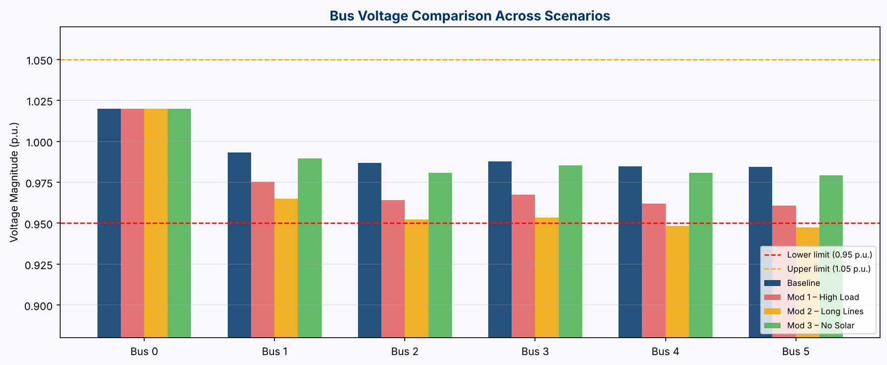
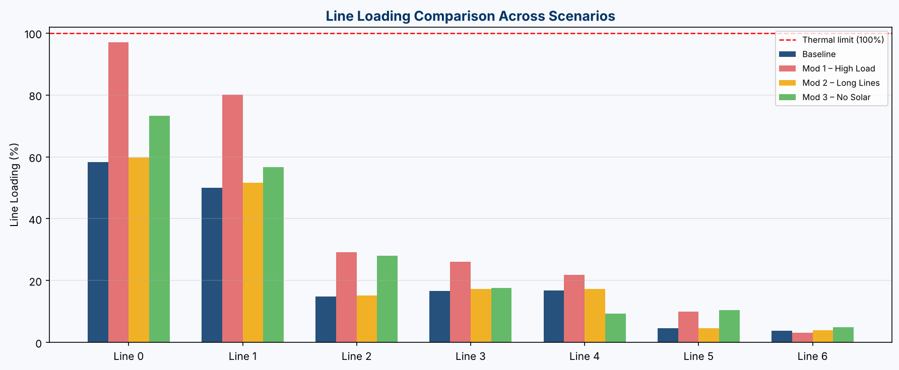

# 6-Bus Power System Simulation with Renewable Integration

**Author:** Dev Kanwar | M.Sc. Power Engineering, BTU Cottbus  
**Tools:** Python · Pandapower · pandas · matplotlib  
**Topic:** AC Power Flow Analysis · Voltage Stability · Renewable Grid Integration

---

## Overview

This was my first power-system project in Python, built during my M.Sc. at
BTU Cottbus to learn load flow hands-on with free tools. It models a
**meshed 6-bus 110 kV network** using [Pandapower](https://www.pandapower.org/), an open-source Python library for power system analysis. A **25 MW solar PV plant** at Bus 2 covers about 18 % of the 140 MW total load.

I run a **Newton-Raphson load flow** for a baseline and three stress tests (more load, longer lines, solar outage) and look at what happens to **bus voltages**, **line loading** and **losses**.

---

## Network Topology

```
Bus 0 (Slack/Grid) ──── Bus 1 (Load) ──── Bus 2 (Solar PV + Load)
        │                    │                        │
        └──── Bus 3 ──── Bus 4 (Mixed) ──── Bus 5 (Light Load)
           (Industrial)
```

| Bus | Type | Description |
|-----|------|-------------|
| 0 | Slack | External grid connection — voltage reference (1.02 p.u.) |
| 1 | PQ Load | Residential / commercial load (30 MW) |
| 2 | PQ Load + Generator | Load (20 MW) + Solar PV (25 MW) |
| 3 | PQ Load | Industrial load (50 MW) |
| 4 | PQ Load | Mixed load (25 MW) |
| 5 | PQ Load | Light load (15 MW) |

**Lines:** 7 transmission lines, 10–30 km each, r = 0.1 Ω/km, x = 0.4 Ω/km, thermal limit = 600 A

---

## Project Structure

```
6-Bus-Power-System-Simulation/
│
├── 6bus_network.py          # Main simulation script
├── requirements.txt         # Python dependencies
├── README.md
│
├── results/
│   ├── bus_results_baseline.csv
│   ├── line_results_baseline.csv
│   ├── bus_results_mod1_increased_load.csv
│   ├── line_results_mod1_increased_load.csv
│   ├── bus_results_mod2_weak_network.csv
│   ├── line_results_mod2_weak_network.csv
│   ├── bus_results_mod3_no_solar.csv
│   └── line_results_mod3_no_solar.csv
│
└── diagrams/
    ├── network_diagram.png
    ├── voltage_comparison.png
    └── line_loading_comparison.png
```

---

## Scenarios

### Baseline
Standard operating condition. All loads active, solar PV generating 25 MW.  
**Result:** all voltages 0.984–1.02 pu, highest line loading 58 %, losses 1.68 MW.

### Modification 1 — Stress Test (Increased Load)
All loads increased by **50%** to simulate peak demand conditions.  
**Purpose:** Identify voltage collapse risk and overloaded lines under high demand.  
**Result:** lowest voltage 0.961 pu (still inside the band), but Line 0-1 reaches **97 %** loading and losses rise from 1.68 to 4.50 MW (**+167 %**). This is the case closest to an overload.

### Modification 2 — Weak Network (Increased Line Length)
All line lengths **doubled**, increasing total impedance (R and X).  
**Purpose:** Simulate a geographically spread or poorly interconnected grid.  
**Result:** **Bus 4 (0.948 pu) and Bus 5 (0.947 pu) drop below 0.95 pu**, the only voltage violations in the study. Losses rise to 3.55 MW (+111 %).

### Modification 3 — Renewable Dependency (Solar Generator Removed)
Solar PV generator at Bus 2 taken offline (`in_service = False`).  
**Purpose:** Quantify the grid's dependency on renewable generation; study what happens when intermittent sources drop out.  
**Result:** voltages stay above 0.979 pu, but the grid import increases, Line 0-1 goes from 58 % to 73 % loading and losses rise to 2.44 MW (+45 %).

---

## How to Run

**1. Clone the repository**
```bash
git clone https://github.com/d-evworks/6-Bus-Power-System-Simulation.git
cd 6-Bus-Power-System-Simulation
```

**2. Install dependencies**
```bash
pip install -r requirements.txt
```

**3. Run the simulation**
```bash
python 6bus_network.py
```

Results are saved automatically to `results/` and `diagrams/`.

---

## Key Concepts

| Term | Meaning |
|------|---------|
| **Bus** | A node in the power network — a point where lines, loads, or generators connect |
| **Slack bus** | The reference bus — fixes voltage magnitude and angle; supplies or absorbs any power imbalance |
| **Load flow / Power flow** | Mathematical calculation of voltages, currents, and power at every point in the grid |
| **Newton-Raphson** | Iterative numerical method used to solve the nonlinear power flow equations |
| **p.u. (per unit)** | Normalised voltage — 1.0 p.u. = nominal voltage; acceptable range is typically 0.95–1.05 p.u. |
| **Line loading %** | How much of a line's maximum current capacity is being used; >100% = overloaded |
| **sgen (static generator)** | Pandapower element for renewable generators (PV, wind) — injects real power |
| **Voltage stability** | The grid's ability to maintain acceptable voltages under varying load and generation conditions |

---

## Results Summary

| Scenario | Min voltage (pu) | Max line loading | Losses |
|---|---|---|---|
| Baseline | 0.984 | 58.3 % | 1.68 MW |
| Load +50 % | 0.961 | **97.1 %** | 4.50 MW (+167 %) |
| Line length ×2 | **0.947** (Bus 4, 5) | 59.8 % | 3.55 MW (+111 %) |
| Solar outage | 0.979 | 73.3 % | 2.44 MW (+45 %) |




**What I took from it:** the weak-network case is the only one that breaks
the voltage band, while peak load is the one that pushes a line close to
its thermal limit. Two different stresses, two different weak points. Local
reactive power support at Bus 4/5 would be the obvious next thing to test.
This small model is also what got me interested in distribution grid
planning, which I followed up in my
[hosting-capacity and N-1 study](https://github.com/d-evworks/Netzplanung-hosting-capacity).

---

## Technologies


---

## Contact

**Dev Kanwar**  
M.Sc. Power Engineering — Brandenburgische Technische Universität Cottbus-Senftenberg  
kanwar.dev0506@gmail.com · [LinkedIn](https://linkedin.com/in/dev-kanwar-b8729124b)
## Side experiment: AI-assisted reporting

[`6 bus ai agent/`](./6%20bus%20ai%20agent) runs a smaller 20 kV variant of
this network through four stress scenarios and compares a plain numeric
report with an automated "agent" report that flags risks and suggests
mitigations.
